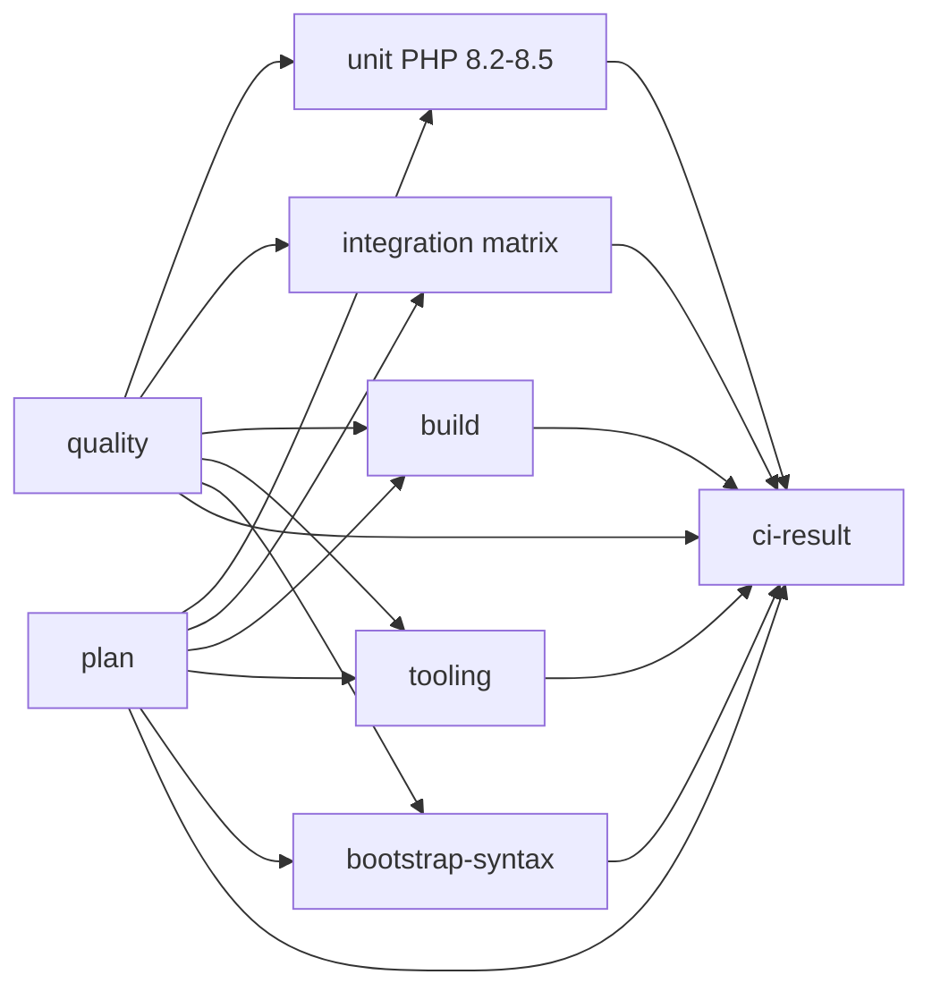

# GitHub validation workflows

The plugin requires PHP 8.2 or newer and WordPress 6.9 or newer. PHP 7.2 is
used only to check the syntax of files loaded before the requirements gate.
It is not a supported plugin runtime.

## Source gate

`ci.yml` is the single source-change gate. It runs on every pull request, on
every push to `main`, and on manual dispatch. A feature-branch push is covered
by its pull request, so the same matrix is not started twice.



| Job | Checks |
|---|---|
| `plan` | Reads the proposed revision only to compare paths: selects the ten-leg pull-request or sixteen-leg full integration matrix and the documentation-only scope; never runs project code, holds `contents: read` and follows the self-hosted switch |
| `quality` | PHPCS/WPCS, PHPCompatibilityWP, PHPStan level 8 without a baseline, version consistency, settings documentation drift and English/Vietnamese documentation parity |
| `bootstrap-syntax` | Real PHP 7.2 parser checks for the entrypoint, `uninstall.php` and `src/Bootstrap/*.php` |
| `unit` | Full unit suite on PHP 8.2, 8.3, 8.4 and 8.5 without coverage instrumentation |
| `integration` | PHP 8.2/8.4 runtime, WordPress 6.9/latest, MCP Adapter 0.7.0/latest, single-site and multisite on pull requests; the default-branch and manual matrix adds PHP 8.3, PHP 8.5 and WordPress trunk (experimental) |
| `build` | Strict Composer manifest validation, packaging regression fixtures, release ZIP build and structural verification on PHP 8.2 |
| `tooling` | Locked npm preparation, dependency contracts, workflow hardening and coverage-acceptance contracts, and service-free Python regression tests |
| `ci-result` | Single stable check for branch protection; fails when a required job failed or was cancelled, and accepts the intentionally skipped source jobs only for a documentation-only pull request |

`unit` and `integration` wait for `quality`, so a lint failure does not spend
an hour on WordPress containers. Pull requests stop each matrix at the first
failure; default-branch runs keep every leg. When the switch is on,
`max-parallel` is the operator-set positive integer `XNETVN_CI_MAX_PARALLEL`
(default `2`); set it to the number of working matching runners. `0` is falsy
and falls back to the hosted width. On GitHub-hosted runners the whole matrix
runs at once, where each job has its own VM. Every integration job stops its disposable `wp-env` in
an `always()` step.

The `plan` job selects the matrix before the source jobs start:

- a pull request runs **ten boundary legs**: PHP 8.2 and 8.4, WordPress 6.9 and
  latest, MCP Adapter 0.7.0 and latest, single-site, plus the PHP 8.2 minimum
  multisite leg and a PHP 8.4/latest/latest multisite leg;
- a default-branch push or a manual dispatch runs the **full
  sixteen legs**, including PHP 8.3, the PHP 8.5 experimental leg and the
  WordPress trunk experimental leg.

The same job decides whether a pull request is documentation-only. Only
`docs/**`, `README.md`, `CONTRIBUTING.md`, `SECURITY.md`, `SUPPORT.md`,
`CODE_OF_CONDUCT.md` and `CHANGELOG.md` qualify. `readme.txt`, `languages/**`,
workflows, scripts, lockfiles and configuration always run the full source gate.
An unavailable base, an empty diff or an unreadable path list also runs the full
gate. A documentation-only pull request still runs `quality` (lint, PHPStan and
the documentation checks) and reports `ci-result`; the source matrix is skipped
with a notice. The coverage workflow applies the same allowlist: it skips its
collectors and reports an explicit artifact-free success (see the coverage gate
below).

`ci-result` is the only context that branch protection should require from this
workflow. Matrix job names include their values (`unit (8.2)`,
`integration (...)`) and disappear when the matrix changes, which leaves a
required check pending forever. The aggregate only reads job results, never
checks out the proposed revision and declares empty permissions, so it follows
the same self-hosted switch as the jobs it summarises.

## Coverage gate

`coverage-check.yml` is independent from the source gate. Packaging and lint
are already enforced by `ci.yml`, so the coverage workflow only runs its own
collectors:

| Job | Evidence |
|---|---|
| `coverage-plan` | Path-scope check: selects the documentation-only fast path; never runs project code and follows the self-hosted switch |
| `helper-tests` | Regression tests for the coverage printer and JSON-only gate |
| `unit` | PHP 8.2 unit coverage with the complete production source filter |
| `integration` | WordPress 6.9 and current stable, single-site and multisite, with the pinned MCP Adapter 0.7.0 |
| `coverage` | Fresh-revision check, thresholds and the no-regression baseline |

The final gate runs with `if: always()`, rejects a failed or cancelled
prerequisite before reading artifacts, and accepts the intentionally skipped
collectors only for a documentation-only pull request. On the full-collection
path it downloads exactly five reports from the same workflow run.
`workflow-contracts.cjs` asserts that the
download names, the gate arguments and the `CoverageGate.php` five-suite roster
all match the integration matrix, so a matrix edit cannot silently strand the
gate. See `COVERAGE_GUIDE.md` for thresholds and evidence rules.

A documentation-only pull request uses the same allowlist as the source gate:
the three collectors are skipped, and the final required check reports success
with an explicit notice instead of reading artifacts. It never claims a coverage
measurement. Any other change, an unavailable base or an unknown path runs all
five suites.

## Workflow self-check

`workflow-lint.yml` is a separate workflow so a broken `ci.yml` cannot prevent
its own lint from starting. It always starts, and a first `changes` job compares
the tested revision with its base:

- when no automation file changed, the costly job is skipped and the
  `workflow-lint` aggregate still reports success, so a required check never
  stays pending;
- when an automation file changed, the `lint` job runs on the trusted runner and
  the aggregate reports its result;
- when the base revision is unavailable or the comparison fails, every workflow
  is linted instead of treating the run as unchanged. Automation files include
  the workflows, `actionlint.yaml`, the workflow contracts, workflow helper
  scripts/actions, `CI_GUIDE.md`, `settings.yml`, `dependabot.yml`, `labeler.yml`
  and the npm lockfiles.

The `lint` job runs:

- `actionlint` 1.7.12, downloaded from the release page and verified against a
  pinned SHA-256 digest;
- `zizmor` 1.30.1 in a temporary virtual environment, offline and with a
  `medium` severity floor, so workflow security regressions fail the lint job;
- `.github/tests/workflow-hardening.cjs`, which enforces empty workflow
  permissions, concurrency groups, timeouts, pinned actions, non-persisted
  checkout credentials, shell-step interpolation safety, the runner trust
  boundary (variable with hosted fallback, hosted-only release and Pages jobs,
  the guarded labeler exception), stable branch-protection contexts, and the
  release/SBOM/Pages/Gitleaks contracts;
- `.github/tests/workflow-contracts.cjs`, which exercises the coverage gate's
  prerequisite guard against all success/failure/cancelled/skipped combinations,
  the workflow-lint aggregate outcomes, the change-detection cases
  (docs-only, workflow edit, rename, delete, unknown base), the CI plan and
  `ci-result` scopes, and the coverage matrix-to-artifact-to-suite mapping.

The `tooling` job runs the same contracts on every source change, so a workflow
contract regression is caught even when the automation files themselves did not
change in that pull request.

## Triggers, cancellation and artifacts

- Pull requests cancel an older run of the same workflow and ref.
- `main` runs are not cancelled: a completed default-branch run is evidence.
- Release, changelog, Pages deployment and the weekly compliance/performance
  runs never cancel each other.
- `sbom.yml` and `plugin-check.yml` are path-filtered because they only depend
  on dependency files and files that can enter the release ZIP. They are not
  required checks.
- `workflow-lint.yml` is intentionally not path-filtered. It filters inside the
  workflow instead, because a required check from a skipped workflow stays
  pending and blocks the pull request.
- `dependency-audit.yml`, `security-scan.yml`, `coverage-check.yml` and
  `ci.yml` are intentionally not path-filtered: a skipped required workflow
  leaves a check pending. Do not add `paths`/`paths-ignore` to a workflow that
  may become a required check without re-reading the GitHub note in the
  references.
- Artifacts use short retention periods. Unit and integration reports are
  evidence from the exact revision, not proof that a later revision passed.
- A full pull-request run measured on 2026-11-03 (run `41671145824` and its
  siblings) consumed about 90 job-minutes before Plugin Check and dependency
  audit (CI 62, coverage 20, security 3, SBOM 3, workflow lint 2). The Free plan
  includes 2,000 minutes per month; confirm the budget or enable an isolated
  runner when appropriate. Running the hosted matrix at full width changes the
  wall-clock time, not the billed job-minutes.
- The 2026-11-04 selector cuts a pull-request run to ten integration legs and
  skips the source matrix for documentation-only pull requests. Those savings
  are expected, not measured; measure them with `gh run list` after merge.

## Security and resource boundaries

The repository is private. `XNETVN_CI_RUNNER` is a **switch**, not a label: a
trusted job runs on the self-hosted runner only when the variable equals `true`
(GitHub compares strings case-insensitively) and the pull request comes from
this repository. The labels live in code,
so a mistyped variable value cannot send a job to an arbitrary label:

```yaml
runs-on: ${{ fromJSON(((inputs.self_hosted_trial) || ((github.event_name != 'pull_request' || github.event.pull_request.head.repo.full_name == github.repository) && vars.XNETVN_CI_RUNNER == 'true')) && '["self-hosted","linux"]' || '"ubuntu-24.04"') }}
```

Two jobs start containers, not just tools: `ci.yml:integration` and
`coverage-check.yml:integration` both run `wp-env`. They need a second switch,
`XNETVN_CI_RUNNER_DOCKER`, so a host whose container network cannot reach its
own containers keeps them hosted while every other job moves:

```yaml
runs-on: ${{ fromJSON(((inputs.self_hosted_trial) || ((github.event_name != 'pull_request' || github.event.pull_request.head.repo.full_name == github.repository) && vars.XNETVN_CI_RUNNER == 'true' && vars.XNETVN_CI_RUNNER_DOCKER == 'true')) && '["self-hosted","linux"]' || '"ubuntu-24.04"') }}
```

The Docker switch narrows the general one, it never replaces it: a `wp-env` job
moves only when both variables are `true`. A manual `self_hosted_trial` dispatch
still sends both kinds to the self-hosted runner, because a trial means the
whole trusted set.

- A `workflow_dispatch` run accepts the boolean `self_hosted_trial` input, so
  the self-hosted path can be trialed without editing the workflows. Only
  repository writers can dispatch a run. Every job in `ci.yml` and
  `coverage-check.yml` follows the switch, so a trial dispatch runs them
  end-to-end without a hosted runner.
- `plan`, `coverage-plan`, `ci-result` and the three `workflow-lint.yml` jobs
  follow the switch. They hold `contents: read` or nothing, never write, and the
  fork guard keeps a pull request from another repository off the persistent
  host. They were hosted before because they were considered meta jobs; a hosted
  `plan` that the account cannot start stops the whole workflow, so a billing
  fault took the source gate and the automation guard down even though every
  expensive job was cost-free.
- The workflow-lint and Gitleaks jobs declare `x64`, because their pinned
  archives are `linux_amd64`/`linux_x64`; every other trusted job uses the broad
  `["self-hosted","linux"]` set.
- A pull request from a fork keeps every switched job on the hosted fallback;
  the labeler does not run for it at all.
- The draft release (`contents: write`) and the Pages deployment (`pages: write`,
  `id-token: write`) are pinned to `ubuntu-24.04` and never touch the persistent
  machine. The pull-request labeler is the single write-token job on the
  self-hosted runner: it never checks out pull-request code, its job is limited
  to pull requests whose head branch lives in this repository, it holds only
  `contents: read` plus `pull-requests: write`, and it first deletes any
  `.github/labeler.yml` left in the persistent workspace so the configuration
  always comes from the base branch. It has no hosted fallback and ignores the
  runner variables: move it back by reverting the workflow or disabling it.
- `max-parallel` for the two `wp-env` matrices is the operator-set positive
  integer `XNETVN_CI_MAX_PARALLEL` (default `2`), not an automatic runner-count
  query; set it to the number of working matching runners. Each runner executes
  one job at a time, so two runners run two `wp-env` jobs on two Docker hosts; a
  value above the real runner count only queues work, and `0` falls back to the
  hosted width.
  Raise it after registering more runners with the `self-hosted` and `linux`
  labels, and lower it when a runner is removed. On GitHub-hosted runners each
  job has its own VM, so the whole matrix runs at once.
- Both currently registered runners carry `self-hosted` and `Linux` (plus `X64`
  and `ubuntu`), so the broad label set matches both. Verify the pool before
  enabling the switch:
  `gh api repos/OWNER/REPO/actions/runners --jq '.runners[] | {name,status,busy,ephemeral,labels:[.labels[].name]}'`.

Enabling the owner-managed runner is a repository-variable change, not a code
change:

```bash
gh variable set XNETVN_CI_RUNNER --body true --repo OWNER/REPO          # non-Docker jobs
gh variable set XNETVN_CI_RUNNER_DOCKER --body true --repo OWNER/REPO   # plus the wp-env jobs
gh variable set XNETVN_CI_MAX_PARALLEL --body 2 --repo OWNER/REPO       # matching runners
gh variable delete XNETVN_CI_RUNNER_DOCKER --repo OWNER/REPO            # wp-env back to hosted
gh variable delete XNETVN_CI_RUNNER --repo OWNER/REPO                   # switched jobs back to hosted (not the labeler)
gh variable delete XNETVN_CI_MAX_PARALLEL --repo OWNER/REPO             # back to the default 2
```

Roll out in two stages. First set `XNETVN_CI_RUNNER`: the jobs that only need
PHP, Node and Composer move, and the two `wp-env` matrices stay hosted. Then
set `XNETVN_CI_RUNNER_DOCKER` only after a probe on that host proves two
containers can reach each other over TCP: a runner can pass every tool step and
still fail `wp-env start` with `Error establishing a database connection` when a
residual Docker `raw`-table `DROP` rule covers the subnet Docker hands to the
new network. DNS still resolves in that state, so only a real TCP probe
separates it from a name-resolution problem.

Enable it only after the runner is isolated (ephemeral/JIT, or cleaned after
every job and declared in `AGENTS.md`) and a trial dispatch with
`self_hosted_trial` passed on the exact labels in the code. Until then every
switched job runs on GitHub-hosted runners. The hosted fallback is evaluated per
run: if a selected self-hosted runner is offline, the job queues (up to 24
hours) instead of moving to hosted; cancel the queued run and rerun it after
deleting the variable. The labeler is not switched by these variables: it always
schedules on the self-hosted runner and only its own workflow revert moves it
back. Do not set the variable while a branch that still reads it as a label is
open: `true` would be looked up as a runner label there.

- Workflow-level `permissions: {}`; each job opens only `contents: read`.
  Write access is limited to the labeler (`pull-requests: write`, on the
  self-hosted runner under the same-repository guard), the draft release job
  (`contents: write`), the Pages deploy job (`pages: write`,
  `id-token: write`) and the CodeQL analysis job (`security-events: write`,
  pinned to the GitHub-hosted runner).
- Third-party actions are pinned to full commit SHAs. Dependabot updates are
  reviewed like code.
- `security-scan.yml` scans the pull-request commit range (`base..merge`) and the
  final merge tree, so a secret added and then removed inside the pull request
  is still reported. If the base revision is unavailable, it scans all fetched
  history instead of falling back to a tree-only scan. Pushes scan only the
  pushed range; the weekly run scans the complete history. Gitleaks runs with
  `--redact` and uploads SARIF artifacts; it does not upload to code scanning.
- Semgrep runs with `--metrics=off` and `--disable-version-check` from a
  temporary virtual environment. Its `p/php` rule pack is still fetched from the
  Semgrep registry at run time, so the rule supply remains a network dependency.
- The SBOM manifest and the draft release both require the Composer and npm
  generators to succeed and all four CycloneDX/SPDX files to be present and
  non-empty. A partial SBOM is retained as a failed-run artifact for diagnosis,
  never attached to a release.
- Trivy uses the canonical `ghcr.io/aquasecurity/trivy-db:2` vulnerability
  database instead of the default mirror, which returned a 404 for the database
  layer on 2026-11-03.
- Checkout credentials are never persisted. No workflow consumes a repository
  secret; the release and Pages jobs use the short-lived `GITHUB_TOKEN`.
- The explicit Composer, static-analysis and Semgrep caches are keyed by the
  runner environment, OS and lockfile. A cache written by one of those steps on
  a self-hosted runner is never restored on a hosted runner, and vice versa.
  `actions/setup-node`'s npm cache uses its own key and is not
  environment-scoped. Pull-request jobs never receive a writable cache that a
  privileged job later trusts.
- Pull requests from forks must require maintainer approval before workflows
  run. Before accepting external forks, enable that setting; do not run
  untrusted pull-request code on a persistent runner.
- A self-hosted runner selected by the switch must provide Docker with Compose
  v2 for `wp-env`, git, Python 3.12 for the SBOM validators and documentation
  checks, and access to the package registries used by the lockfiles. PHP and
  Node are installed per job by the pinned setup actions. The `wp-env` jobs
  prefer IPv4 and disable the 250 ms address-family auto-selection
  (`NODE_OPTIONS=--dns-result-order=ipv4first --no-network-family-autoselection`),
  so a runner with broken IPv6 egress does not hang on the WordPress download.
- Runner work directories are disposable. Integration jobs clean stale
  `wp-env` locks, stop their containers, reset the managed WordPress checkouts
  and remove the project's Docker volumes before start, keeping images and local
  files. They stop their own environment in an `always()` step.

`.github/tests/workflow-hardening.cjs` enforces the runner trust boundary,
`permissions: {}`, `concurrency` groups that include `github.workflow`, job
timeouts, pinned actions, non-persisted checkout credentials, shell-step
interpolation safety, stable required contexts and the
release/SBOM/Pages/Gitleaks contracts. Run
`node .github/tests/workflow-hardening.cjs` and `actionlint` after any workflow
change.

## GitHub Pages

`docs-deploy.yml` builds the documentation bundle on documentation changes
pushed to `main`. Deployment is disabled by default because Pages is not enabled on this
repository. After the owner enables Pages, set the repository variable
`XNETVN_PAGES_ENABLED` to `true`; the deploy job then runs on `main` with the
`github-pages` environment. The workflow reports a notice instead of failing
while the variable is unset. The uploaded artifact is the raw Markdown bundle;
`deploy-pages` serves those files as uploaded. A rendered HTML site generator is
a separate change. Enabling Pages or changing repository settings is an owner
action.

## Release flow

A `v*` tag starts three independent workflows:

1. `changelog.yml` validates the version against the plugin header,
   `readme.txt` and `CHANGELOG.md`, and uploads the matching release notes.
2. `compliance-check.yml` verifies the license text, version consistency,
   changelog format, security policy and translation template.
3. `release.yml` generates CycloneDX/SPDX SBOMs, validates the manifest and
   Composer advisories, verifies that both generators produced all four files,
   and creates a **draft** GitHub Release with the plugin ZIP and SBOM assets.
   If either SBOM generator fails, the draft job is skipped rather than
   publishing an incomplete set.

Publishing the draft is a manual owner action. The draft workflow does not wait
for the changelog workflow; inspect both runs before publishing. The release
job keeps `contents: write` scoped to the draft job only.

## Acceptance boundaries

The [M1 specification](../docs/en/specs/M1-core.md) and
[roadmap](../docs/en/roadmap.md) define release coverage requirements of at
least 80% overall and at least 90% for Domain/Auth/Policy, with additional
unit-only requirements for Domain and pure Auth helpers. The
[coverage procedure](../docs/en/development-coverage.md) measures the combined
unit/integration scope on the remote lab. `coverage-check.yml` enforces its own
documented thresholds; it does not merge the remote-lab acceptance evidence.

These checks do not establish real MCP client compatibility, HTTP acceptance,
load capacity, horizontal scaling, legal compliance, production readiness or
WordPress.org directory acceptance. Independent security review remains a
separate gate. Publishing and repository/server setting changes require
explicit authorization.

## Official references

- [Reusable workflows and same-commit local references](https://docs.github.com/en/actions/how-tos/reuse-automations/reuse-workflows)
- [Workflow syntax, job dependencies and path filters](https://docs.github.com/en/actions/reference/workflows-and-actions/workflow-syntax)
- [Secure use of GitHub Actions](https://docs.github.com/en/actions/reference/security/secure-use)
- [Issue form syntax](https://docs.github.com/en/communities/using-templates-to-encourage-useful-issues-and-pull-requests/syntax-for-issue-forms)
