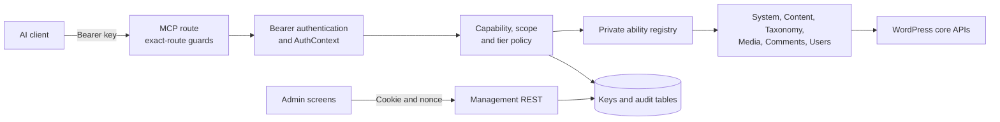

<div align="center">

# xNetVN Agent Hub WP

**A capability-scoped MCP server that lets AI agents read and change WordPress only within the permissions of the person who issued the API key.**

**Version 1.0.0** — 62 private abilities across six ability packs.

Formerly xNetVN Agent Hub for WordPress.

[Documentation](docs/en/README.md) · [Installation](docs/en/INSTALL.md) · [Architecture](docs/en/architecture/overview.md) · [Threat model](docs/en/security/threat-model.md) · [Report a bug](https://github.com/xnetvn-com/xnetvn-agent-hub-wp/issues/new?template=bug_report.yml) · [Request a feature](https://github.com/xnetvn-com/xnetvn-agent-hub-wp/issues/new?template=feature_request.yml)

</div>

## Overview

WordPress 6.9 ships the Abilities API, and the official MCP Adapter can expose those abilities to AI clients. The hard part is not connecting an agent; it is keeping the agent inside the permissions of the person who asked it to work, and making every key revocable, scoped and auditable.

xNetVN Agent Hub adds that control layer as a WordPress plugin. Each MCP key belongs to a WordPress user, can only narrow that user's current capabilities, and is checked again on every request. The MCP endpoint accepts bearer keys only, while key management stays behind a cookie and REST nonce.

## Features

| | Feature | What you get |
|---|---|---|
| 🔑 | User-owned API keys | `xnv_…` keys bound to one WordPress user; the secret is shown once and stored as HMAC-SHA256 with a separate per-site pepper. |
| 🛡️ | Capability intersection | A call succeeds only when core capabilities, key scope, tier ceiling, toolset and site settings all allow it. The `admin` tier is off by default. |
| 🔀 | Split authentication | The MCP route accepts bearer keys only; management REST accepts a login cookie plus `wp_rest` nonce only. |
| 🧰 | Six ability packs | 62 private abilities: system (5), content (19), taxonomy (9), media (7), comments (10) and users (12). |
| 🧾 | Audit and privacy | Only top-level argument names are recorded; retention, IP masking and WordPress personal-data export/erasure are supported. |
| 🖥️ | Admin screens | Administrator pages for overview, all-owner keys, activity, tools, settings and connection help; every user creates their own keys on their profile. |

## Requirements

- WordPress 6.9 or later (tested against 7.1.2).
- PHP 8.2 or later.
- The official [MCP Adapter](https://wordpress.org/plugins/mcp-adapter/) plugin, version `>=0.7.0 <0.8.0`, installed and active to use MCP. The plugin can be activated first; MCP stays disabled with an admin notice until a supported adapter is active.
- MySQL 8.0 or later, or MariaDB 10.6 or later, with InnoDB.
- HTTPS in production; insecure transport is a development-only opt-in.
- For development: Composer 2.4+ and Node.js 24. Integration, browser and E2E suites run in a separate lab environment, not on a workstation.

## Quick start

```bash
composer install
composer check
composer build
```

Expected result: `composer check` passes the WordPress coding standard, PHP 7.2 bootstrap syntax, PHPStan level 8, the unit suite and the documentation gates. `composer build` writes `dist/xnetvn-agent-hub-wp-1.0.0.zip`.

Node dependencies (`npm ci`) are needed for the tooling and browser suites. See the [testing guide](docs/en/TESTING.md) for the lab-backed commands.

## Installation

1. Install and activate the official MCP Adapter from the WordPress plugin directory.
2. In WordPress administration, open **Plugins → Add New Plugin → Upload Plugin**, choose the ZIP from `dist/`, install and activate it.
3. Open **Agent Hub** in the admin menu and review the settings before issuing a key.

Release archives are generated by `composer build`; the source checkout itself needs the Composer autoloader.

## Usage

1. Open your profile (**Users → Profile**) and create a key in the Agent Hub section. The secret is displayed once; copy it before leaving the page.
2. Point an MCP client at the site endpoint and send the key as a bearer token:

```http
POST https://example.com/wp-json/xnetvn-agent-hub-wp/mcp
Authorization: Bearer redacted
Content-Type: application/json
```

3. Administrators can use **Agent Hub → Help** for a ready configuration sample; the [operation guide](docs/en/guides/operation-guide.md) covers the key lifecycle, scopes and client setup.

Every request rechecks the key owner's current capabilities, so role changes and user deletion take effect immediately.

## Configuration

| Setting | Default | Description |
|---|---|---|
| `tier_ceiling` | `destructive` | Highest risk tier a key may request. |
| `allow_admin_tier` | `false` | Keeps `admin`-tier abilities disabled. |
| `rate_limit_key_per_min` | `120` | Requests allowed per key per minute. |
| `media_remote_fetch_enabled` | `false` | Allows tools to download public HTTPS media URLs. |

The full inventory, including proxy, audit and media limits, is in [ENVIRONMENT.md](docs/en/ENVIRONMENT.md).

> [!WARNING]
> Deleting the plugin removes keys, audit records and settings by default (`delete_data_on_uninstall`). Export what you need or disable that setting before uninstalling.

## Architecture



The registry is the only source of ability metadata, and the adapter boundary is a single gateway. See the [architecture overview](docs/en/architecture/overview.md) for the request lifecycle and layer boundaries.

## Roadmap

The system, content, taxonomy, media, comments and users packs are implemented. Blocks, appearance, settings, plugins and maintenance remain planned. OAuth is not implemented: every MCP client authenticates with a user-owned bearer key. Status per milestone is tracked in the [roadmap](docs/en/roadmap.md) and [CHANGELOG.md](CHANGELOG.md), and every ability is listed in the [ability catalog](docs/en/architecture/ability-catalog.md).

## Documentation

- [Documentation index](docs/en/README.md) and [Vietnamese translations](docs/vi/README.md)
- [Project wiki](https://github.com/xnetvn-com/xnetvn-agent-hub-wp/wiki) for the task-oriented guide, the security model and the engineering pages
- [User guide](docs/user-guide.md) for WordPress.org users
- [Development guide](docs/en/development.md) and [testing guide](docs/en/TESTING.md)
- [API key design](docs/en/architecture/api-keys.md) and [operations](docs/en/operations.md)
- [Plugin readme for WordPress](readme.txt)

## Contributing

Contributions are welcome. Read [CONTRIBUTING.md](CONTRIBUTING.md) before opening a pull request; work on a feature branch and keep `composer check` green.

## Security

Please do not report vulnerabilities in public issues. See [SECURITY.md](SECURITY.md) for private reporting and the [threat model](docs/en/security/threat-model.md) for the defended boundaries.

## Support

Open an issue for bugs and feature requests, or read [SUPPORT.md](SUPPORT.md) for the support channels.

## License

Released under the GNU General Public License v2.0 or later. See [LICENSE](LICENSE).
