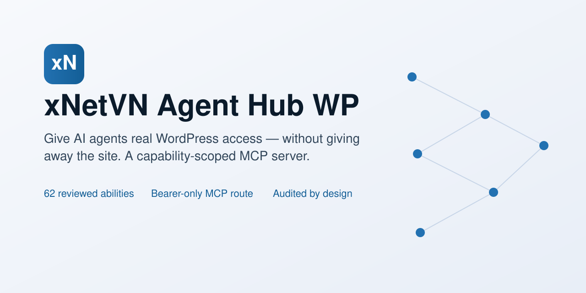

<a id="readme-top"></a>

<div align="center">

<picture>
  <source media="(prefers-color-scheme: dark)" srcset="docs/assets/banner-dark.svg">
  
</picture>

# xNetVN Agent Hub WP

**A capability-scoped MCP server that keeps AI agents within the permissions of the user who issued the key.**

**[Wiki][wiki]** · **[User guide][user-guide]** · **[Report a bug][bug]** · **[Request a feature][feature]** · **[Discussions][discussions]**

[![CI][badge-ci]][link-ci] [![CodeQL][badge-codeql]][link-codeql] [![Security Scan][badge-security]][link-security]

[![PHP][badge-php]][composer] [![Version][badge-version]][changelog] [![License][badge-license]][license]

[![Discussions][badge-discussions]][discussions] [![Stars][badge-stars]][stargazers] [![Contributors][badge-contributors]][contributors]

[![Share on X][img-share-x]][share-x] [![Share on Facebook][img-share-facebook]][share-facebook] [![Share on LinkedIn][img-share-linkedin]][share-linkedin] [![Share on Reddit][img-share-reddit]][share-reddit] [![Share on Telegram][img-share-telegram]][share-telegram] [![Share on WhatsApp][img-share-whatsapp]][share-whatsapp] [![Share on Bluesky][img-share-bluesky]][share-bluesky] [![Share on Mastodon][img-share-mastodon]][share-mastodon]

</div>

<details>
<summary><strong>Table of contents</strong></summary>

- **[Overview](#overview)**
- **[Key Features](#key-features)**
- **[Demo](#demo)**
- **[How It Works](#how-it-works)**
- **[Quick Start](#quick-start)**
- **[Installation](#installation)**
- **[Usage](#usage)**
- **[Configuration](#configuration)**
- **[Documentation](#documentation)**
- **[FAQ](#faq)**
- **[Roadmap & Changelog](#roadmap--changelog)**
- **[Join Our Community](#join-our-community)**
- **[Contributing](#contributing)**
- **[Security](#security)**
- **[Contact](#contact)**
- **[Acknowledgments](#acknowledgments)**
- **[License](#license)**

</details>

## Overview

An MCP client gives an AI agent hands. The hard part is not connecting it; it is keeping those hands inside the permissions of the person who asked for the work, and being able to prove afterwards what happened. A shared token with broad rights is easy to set up and impossible to defend.

xNetVN Agent Hub WP adds that control layer to WordPress 6.9 and later. Every key belongs to one WordPress user, the key can only narrow what that user may already do, the owner's capabilities are rechecked on every request, and each call can be reviewed in an audit log.

- **Capability intersection, not a parallel permission system**: a call passes only when the owner's core capability, the key tier and toolsets, the site ceiling, the allow/deny lists and the authenticated transport all agree (`src/Policy/Policy.php`).
- **Split authentication**: the MCP route accepts bearer keys only; key management accepts a login cookie plus a REST nonce only, and a cookie identity never substitutes for a key (`src/Rest/ManagementGate.php`).
- **Privacy-shaped audit**: records keep identity, outcome, timing, transport and top-level argument names, never argument values, tokens, hashes or cookies (`src/Audit/AuditEvent.php`).

## Key Features

| | Feature | What you get |
|---|---|---|
| 🔑 | User-owned keys | `xnv_…` keys bound to one WordPress user; the secret is shown once and stored as HMAC-SHA256 with a separate random per-site pepper. |
| 🛡️ | Capability intersection | A call succeeds only when core capabilities, key scope, tier ceiling, toolset and site settings all allow it. The `admin` tier is off by default. |
| 🔀 | Split authentication | Bearer keys on the MCP route; cookie plus `wp_rest` nonce on management routes. Neither credential works on the other surface. |
| 🧰 | 62 reviewed abilities | Six toolsets: system (5), content (19), taxonomy (9), media (7), comments (10) and users (12), each with a strict input and output schema. **[See the catalog][catalog]**. |
| 🧾 | Audit and privacy | Top-level argument names only, bounded retention, optional IP anonymisation, and WordPress personal-data export and erasure support. |
| 🚫 | Permanent exclusions | No arbitrary PHP, SQL or shell execution, no file editors, no secret or key-management tools, and no public abilities. |

## Demo


**From a fresh install to a first authenticated call in a few minutes.** The screens below show the key lifecycle, the activity log and the access settings; the **[project wiki][wiki]** walks through every screen.

| Keys | Activity | Access settings |
|---|---|---|
|  |  |  |

## How It Works


Only `src/Mcp/ServerGateway.php` holds the adapter class and hook dependencies, so an adapter upgrade stays inside one facade. **[The architecture overview][architecture]** describes the request lifecycle and the layer boundaries.

## Quick Start

**Requirements:** WordPress 6.9+, PHP 8.2+, MySQL 8.0+ or MariaDB 10.6+ with InnoDB, HTTPS in production, and the official MCP Adapter `>=0.7.0 <0.8.0` to enable MCP.

```bash
composer install
composer build
```

Expected result: `composer build` writes `dist/xnetvn-agent-hub-wp-1.0.0.zip`, a release archive that already contains the Composer autoloader.

## Installation

<details>
<summary><strong>From a locally built ZIP</strong></summary>

1. Build the ZIP from a checkout with `composer build` (written to `dist/`).
2. In WordPress, open **Plugins → Add New Plugin → Upload Plugin**, choose the ZIP and select **Install Now**.
3. Activate the plugin, then activate the official MCP Adapter `0.7.x` to enable MCP (**[installation guide][install]**).

</details>

<details>
<summary><strong>From a source checkout</strong></summary>

```bash
cd wp-content/plugins
git clone https://github.com/xnetvn-com/xnetvn-agent-hub-wp.git xnetvn-agent-hub-wp
cd xnetvn-agent-hub-wp
composer install --no-dev --optimize-autoloader
wp plugin activate xnetvn-agent-hub-wp
```

A fresh checkout without `vendor/` refuses to boot and shows a "dependencies are missing" notice instead of a fatal error (`src/Bootstrap/Loader.php`).

</details>

<details>
<summary><strong>From WordPress.org</strong></summary>

The plugin is not listed in the WordPress.org directory yet, so install it from the ZIP or a source checkout above. `readme.txt` uses the directory format for a future submission.

</details>

<details>
<summary><strong>Activation order and the adapter</strong></summary>

Both orders work. The plugin does not declare a hard `Requires Plugins` header: it activates without the adapter, shows an admin notice, and keeps the MCP server disabled until a supported adapter is active. The accepted range is exact, `0.7.0` or later and below `0.8.0`; an unsupported version is reported instead of being used (`src/Mcp/ServerGateway.php`).

</details>

## Usage

1. Open **Users → Profile** and create a key with the lowest tier and the toolsets your client needs. Copy the key now: it is shown once.
2. Point the client at the site's MCP endpoint and send the key as a bearer token.
3. Confirm the first call, then watch it in **Agent Hub → Activity**.

```bash
curl -sS https://example.com/wp-json/xnetvn-agent-hub-wp/mcp \
  -H "Authorization: Bearer $XNETVN_KEY" \
  -H "Content-Type: application/json" \
  -H "Accept: application/json, text/event-stream" \
  -H "MCP-Protocol-Version: 2026-07-28" \
  -H "Mcp-Method: tools/list" \
  -d '{
    "jsonrpc": "2.0",
    "id": 1,
    "method": "tools/list",
    "params": {
      "_meta": {
        "io.modelcontextprotocol/protocolVersion": "2026-07-28",
        "io.modelcontextprotocol/clientInfo": { "name": "example-agent", "version": "1.0.0" },
        "io.modelcontextprotocol/clientCapabilities": {}
      }
    }
  }'
```

Expected result: a JSON-RPC response whose tool list contains only the abilities the key's tier, toolsets and scope allow. The `2026-07-28` profile is sessionless, so every request repeats these headers and the `_meta` block; the older `2025-11-25` handshake needs `initialize` and `Mcp-Session-Id` instead. The full envelope, including the `tools/call` variant with `Mcp-Name`, is in the **[AI agent skill pack][skill-pack]** and its **[connection guide][skill-connect]**.

## Configuration

All settings live under **Agent Hub → Settings** and are stored per site.

| Setting | Default | What it controls |
|---|---|---|
| `enabled` | `true` | Whether the MCP server may start at all. |
| `tier_ceiling` | `destructive` | Highest risk tier any key on this site may request. |
| `allow_admin_tier` | `false` | Whether the `admin` tier can be granted. |
| `allowed_origins` | empty | Exact browser origins allowed to call the MCP route. |
| `rate_limit_key_per_min` | `120` | Requests allowed per key per minute. |
| `audit_retention_days` | `90` | Days an activity row is kept before the cleanup job removes it. |
| `media_remote_fetch_enabled` | `false` | Whether media abilities may download from a remote URL. |
| `delete_data_on_uninstall` | `true` | Whether deleting the plugin removes its keys, activity rows and settings. |

Every setting, with ranges and defaults: **[environment reference][environment]**.

## Documentation

- **[Documentation index][docs]** and the Vietnamese translations
- **[Project wiki][wiki]** for the task-oriented guide, the security model and the engineering pages
- **[User guide][user-guide]** for every screen and setting
- **[Installation][install]**, **[environment reference][environment]** and **[operations][operations]**
- **[Architecture][architecture]**, **[API key design][api-keys]** and **[threat model][threat-model]**
- **[AI agent skill pack][skill-pack]** for connecting an agent, choosing scope and recovering from failures
- **[Development][development]**, **[testing][testing]**, **[changelog][changelog]** and **[roadmap][roadmap]**

## FAQ

<details>
<summary><strong>Do I need another plugin?</strong></summary>

Yes, to use MCP. Install and activate the official MCP Adapter `0.7.x`. The plugin itself activates without it and keeps MCP disabled with an admin notice.

</details>

<details>
<summary><strong>Can agents run arbitrary PHP, SQL or shell commands?</strong></summary>

No. Those capabilities are permanently excluded. The 62 abilities cover content, taxonomy, media, comments, users and safe system discovery, each with fixed descriptions and strict schemas.

</details>

<details>
<summary><strong>How are API keys stored?</strong></summary>

A key is 60 characters in the form `xnv_<key_id>_<secret>`. The plaintext is shown once and never stored; the database keeps an HMAC-SHA256 hash and a key identifier, with a separate random 32-byte pepper in the site options.

</details>

<details>
<summary><strong>Which MCP clients work?</strong></summary>

Any client that can send a bearer token in the `Authorization` header **and** speaks an MCP HTTP profile the adapter supports: the `2026-07-28` sessionless profile, or the `2025-11-25` handshake with `initialize` and `Mcp-Session-Id`. OAuth is not implemented, so a client that requires an OAuth flow cannot connect. The client gate is prepared for MCP Inspector 2.9.0 and the FastMCP Slim 4.0.11 CLI, not desktop GUI clients; runtime acceptance of those clients remains unverified.

</details>

<details>
<summary><strong>What happens to my data when I uninstall?</strong></summary>

By default, deleting the plugin drops its keys and activity tables and removes its options and scheduled events. Turn off **Delete plugin data when uninstalled** before deleting the plugin if you want to keep that data. Content, media and terms created by agents are never deleted.

</details>

<p align="right"><a href="#readme-top"><strong>Back to top</strong></a></p>

## Roadmap & Changelog

The content, taxonomy, media, comments, users and system packs are implemented. Blocks, appearance, settings, plugins and maintenance remain planned. Status per milestone is tracked in the **[roadmap][roadmap]**, every released change is recorded in **[CHANGELOG.md][changelog]**, and every ability is listed in the **[catalog][catalog]**.

## Join Our Community

- Ask and answer questions in **[GitHub Discussions][discussions]**.
- Read the **[Code of Conduct][code-of-conduct]** and **[how to get support][support]**.
- Report a reproducible bug with the **[bug form][bug]** and propose a change with the **[feature form][feature]**.

## Contributing

Contributions are welcome. Read **[CONTRIBUTING.md][contributing]** before opening a pull request, keep commits in Conventional Commits form, and run `composer check` locally. New here? Start with an issue labelled **[good first issue][good-first-issue]**. Thanks to **[every contributor][contributors]**.

## Security

Please do not report vulnerabilities in public issues. Read the **[security policy][security-policy]** and **[report a vulnerability privately][advisory]**. Remove keys, passwords, personal data and authorization headers from every report.

## Contact

- Security: **[security@xnetvn.net][contact]**
- Website: **[xnetvn.com][website]**

## Acknowledgments

The plugin is built on the WordPress Abilities API and the official MCP Adapter. It also relies on Composer, PHPUnit, PHPStan, PHP_CodeSniffer and the WordPress coding standards; the **[composer.json][composer]** lists every development dependency.

<p align="right"><a href="#readme-top"><strong>Back to top</strong></a></p>

## License

Released under the GNU General Public License v2.0 or later by xNetVN Inc. See **[LICENSE][license]**.

<!-- Link registry: every reference link and image of this README. [repo] is the URL the share links must carry. -->

[repo]: https://github.com/xnetvn-com/xnetvn-agent-hub-wp
[wiki]: https://github.com/xnetvn-com/xnetvn-agent-hub-wp/wiki
[user-guide]: docs/user-guide.md
[bug]: https://github.com/xnetvn-com/xnetvn-agent-hub-wp/issues/new?template=bug_report.yml
[feature]: https://github.com/xnetvn-com/xnetvn-agent-hub-wp/issues/new?template=feature_request.yml
[discussions]: https://github.com/xnetvn-com/xnetvn-agent-hub-wp/discussions
[issues]: https://github.com/xnetvn-com/xnetvn-agent-hub-wp/issues
[milestones]: https://github.com/xnetvn-com/xnetvn-agent-hub-wp/milestones
[good-first-issue]: https://github.com/xnetvn-com/xnetvn-agent-hub-wp/labels/good%20first%20issue
[stargazers]: https://github.com/xnetvn-com/xnetvn-agent-hub-wp/stargazers
[contributors]: https://github.com/xnetvn-com/xnetvn-agent-hub-wp/graphs/contributors
[advisory]: https://github.com/xnetvn-com/xnetvn-agent-hub-wp/security/advisories/new
[website]: https://xnetvn.com/
[contact]: mailto:security@xnetvn.net
[docs]: docs/en/README.md
[install]: docs/en/INSTALL.md
[environment]: docs/en/ENVIRONMENT.md
[architecture]: docs/en/architecture/overview.md
[api-keys]: docs/en/architecture/api-keys.md
[threat-model]: docs/en/security/threat-model.md
[catalog]: docs/en/architecture/ability-catalog.md
[development]: docs/en/development.md
[testing]: docs/en/TESTING.md
[operations]: docs/en/operations.md
[roadmap]: docs/en/roadmap.md
[skill-pack]: docs/en/guides/agent-skill-pack.md
[skill-connect]: skills/xnetvn-agent-hub-wp/references/connect.md
[changelog]: CHANGELOG.md
[contributing]: CONTRIBUTING.md
[code-of-conduct]: CODE_OF_CONDUCT.md
[support]: SUPPORT.md
[security-policy]: SECURITY.md
[license]: LICENSE
[composer]: composer.json

[link-ci]: https://github.com/xnetvn-com/xnetvn-agent-hub-wp/actions/workflows/ci.yml
[link-codeql]: https://github.com/xnetvn-com/xnetvn-agent-hub-wp/actions/workflows/codeql.yml
[link-security]: https://github.com/xnetvn-com/xnetvn-agent-hub-wp/actions/workflows/security-scan.yml
[badge-ci]: https://github.com/xnetvn-com/xnetvn-agent-hub-wp/actions/workflows/ci.yml/badge.svg
[badge-codeql]: https://github.com/xnetvn-com/xnetvn-agent-hub-wp/actions/workflows/codeql.yml/badge.svg
[badge-security]: https://github.com/xnetvn-com/xnetvn-agent-hub-wp/actions/workflows/security-scan.yml/badge.svg
[badge-php]: https://img.shields.io/badge/php-8.2+-777bb4
[badge-version]: https://img.shields.io/badge/version-1.0.0-2f6f4e
[badge-license]: https://img.shields.io/github/license/xnetvn-com/xnetvn-agent-hub-wp
[badge-discussions]: https://img.shields.io/github/discussions/xnetvn-com/xnetvn-agent-hub-wp
[badge-stars]: https://img.shields.io/github/stars/xnetvn-com/xnetvn-agent-hub-wp
[badge-contributors]: https://img.shields.io/github/contributors/xnetvn-com/xnetvn-agent-hub-wp

[share-x]: https://x.com/intent/tweet?text=xNetVN%20Agent%20Hub%20WP%20%E2%80%94%20a%20capability-scoped%20MCP%20server%20for%20WordPress&url=https%3A%2F%2Fgithub.com%2Fxnetvn-com%2Fxnetvn-agent-hub-wp
[share-facebook]: https://www.facebook.com/sharer/sharer.php?u=https%3A%2F%2Fgithub.com%2Fxnetvn-com%2Fxnetvn-agent-hub-wp
[share-linkedin]: https://www.linkedin.com/sharing/share-offsite/?url=https%3A%2F%2Fgithub.com%2Fxnetvn-com%2Fxnetvn-agent-hub-wp
[share-reddit]: https://www.reddit.com/submit?url=https%3A%2F%2Fgithub.com%2Fxnetvn-com%2Fxnetvn-agent-hub-wp&title=xNetVN%20Agent%20Hub%20WP%20%E2%80%94%20a%20capability-scoped%20MCP%20server%20for%20WordPress
[share-telegram]: https://t.me/share/url?url=https%3A%2F%2Fgithub.com%2Fxnetvn-com%2Fxnetvn-agent-hub-wp&text=xNetVN%20Agent%20Hub%20WP%20%E2%80%94%20a%20capability-scoped%20MCP%20server%20for%20WordPress
[share-whatsapp]: https://wa.me/?text=xNetVN%20Agent%20Hub%20WP%20%E2%80%94%20a%20capability-scoped%20MCP%20server%20for%20WordPress%20https%3A%2F%2Fgithub.com%2Fxnetvn-com%2Fxnetvn-agent-hub-wp
[share-bluesky]: https://bsky.app/intent/compose?text=xNetVN%20Agent%20Hub%20WP%20%E2%80%94%20a%20capability-scoped%20MCP%20server%20for%20WordPress%20https%3A%2F%2Fgithub.com%2Fxnetvn-com%2Fxnetvn-agent-hub-wp
[share-mastodon]: https://mastodon.social/share?text=xNetVN%20Agent%20Hub%20WP%20%E2%80%94%20a%20capability-scoped%20MCP%20server%20for%20WordPress%20https%3A%2F%2Fgithub.com%2Fxnetvn-com%2Fxnetvn-agent-hub-wp
[img-share-x]: https://img.shields.io/badge/Share%20on-X-000000?logo=x&logoColor=white
[img-share-facebook]: https://img.shields.io/badge/Share%20on-Facebook-1877F2?logo=facebook&logoColor=white
[img-share-linkedin]: https://img.shields.io/badge/Share%20on-LinkedIn-0A66C2?logo=linkedin&logoColor=white
[img-share-reddit]: https://img.shields.io/badge/Share%20on-Reddit-FF4500?logo=reddit&logoColor=white
[img-share-telegram]: https://img.shields.io/badge/Share%20on-Telegram-26A5E4?logo=telegram&logoColor=white
[img-share-whatsapp]: https://img.shields.io/badge/Share%20on-WhatsApp-25D366?logo=whatsapp&logoColor=white
[img-share-bluesky]: https://img.shields.io/badge/Share%20on-Bluesky-0285FF?logo=bluesky&logoColor=white
[img-share-mastodon]: https://img.shields.io/badge/Share%20on-Mastodon-6364FF?logo=mastodon&logoColor=white
