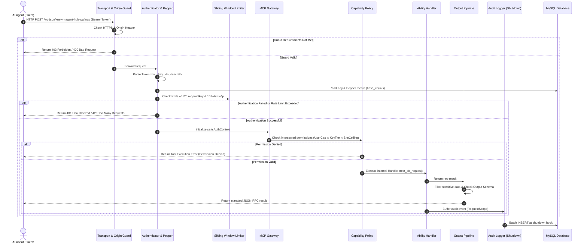
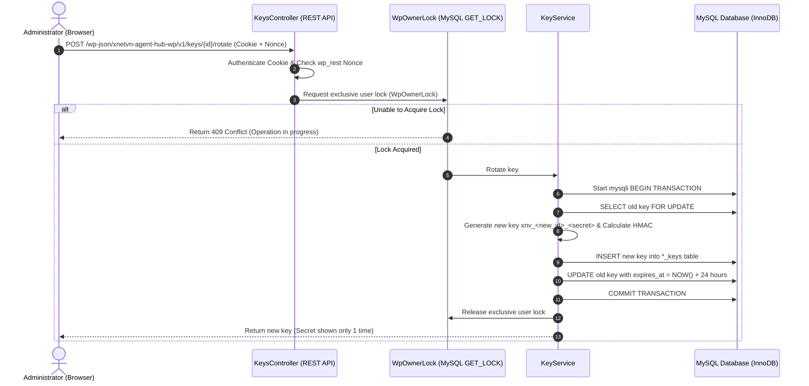

# Main Data Flow Diagram (DFD)

> **Modeling the path of data through the processing layers of xNetVN Agent Hub WP.**

---

## 1. MCP Request Flow Diagram

---

## 2. Atomic API Key Rotation Flow Diagram

