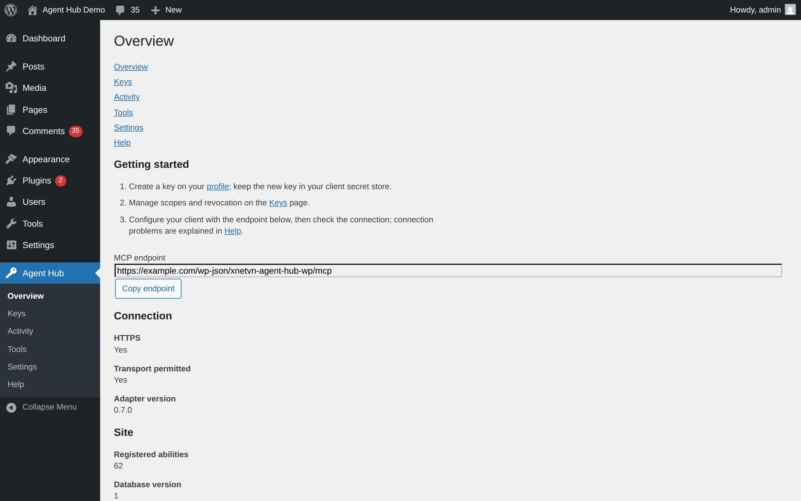
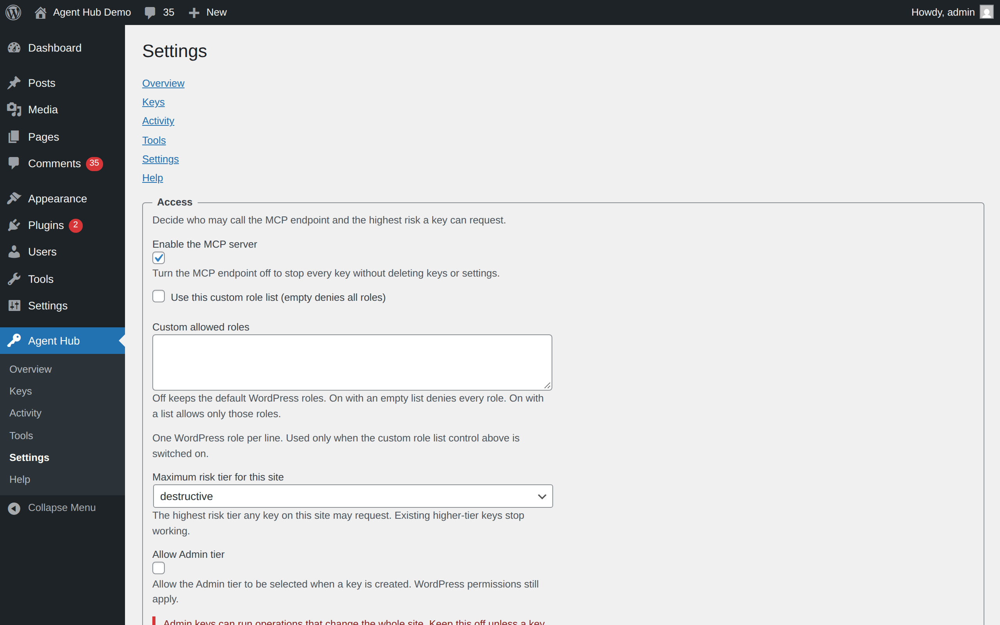
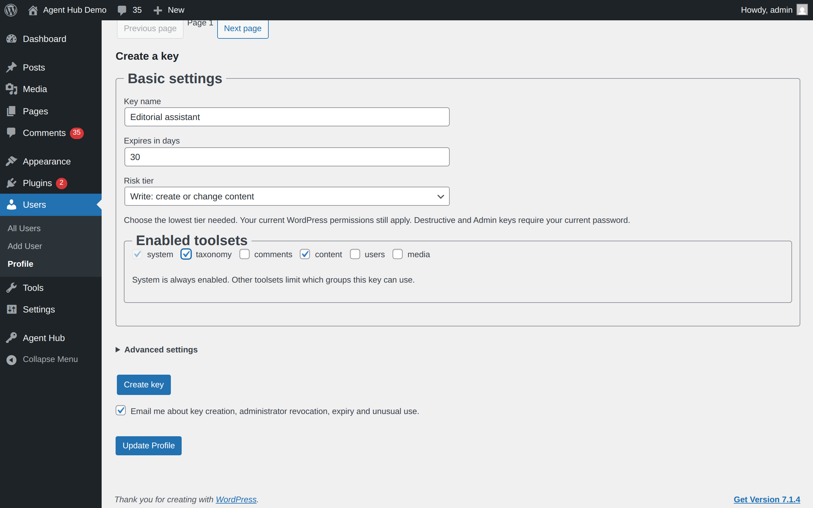
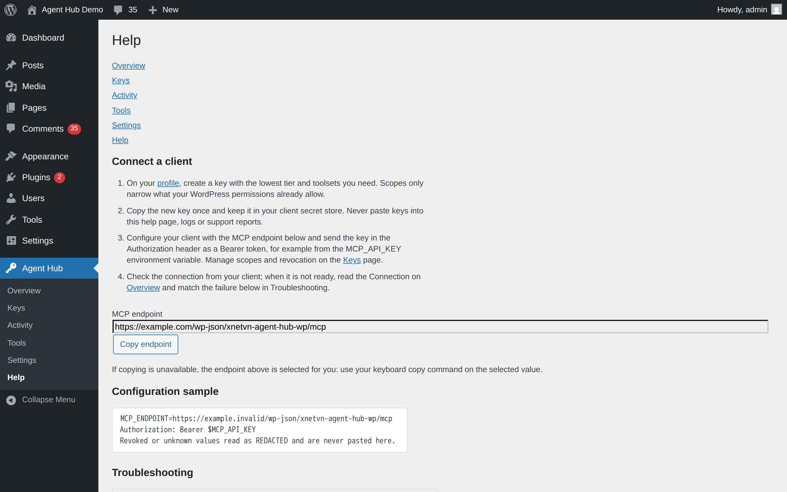
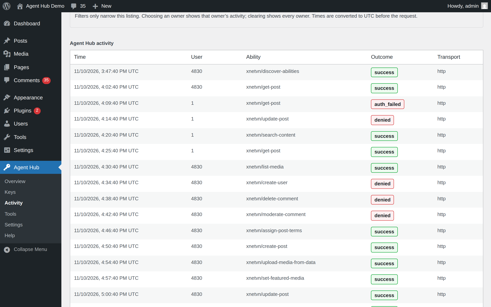
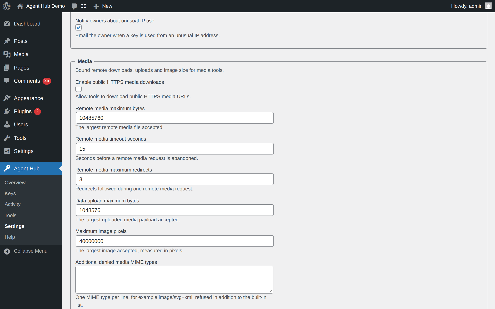

# xNetVN Agent Hub WP user guide

Version 1.0.0 · last checked against the code on 2026-11-10

xNetVN Agent Hub WP adds a private Model Context Protocol (MCP) server to WordPress. An AI agent connects with a key that belongs to a WordPress user; every request is checked against that user's current permissions and the key's own scope, and each call can be recorded in the activity log. The plugin also gives administrators and key owners the screens needed to create, scope, review and revoke that access.

## Requirements

- WordPress 6.9 or later, PHP 8.2 or later.
- The official MCP Adapter 0.7.x (0.7.0 or later, below 0.8.0), installed and active.
- HTTPS on the site that serves the MCP endpoint. The plugin refuses an insecure transport.
- An MCP client that can send a bearer token in the `Authorization` header. OAuth is not supported.

## Install

1. In your dashboard, go to Plugins > Add New Plugin, search for "MCP Adapter", install and activate it.
2. Search for "xNetVN Agent Hub WP", select Install Now, then Activate.
3. For a source checkout, run `composer install` inside the plugin directory before activation.

If the MCP Adapter is missing or outside 0.7.x, WordPress reports the dependency, and the plugin shows an admin notice instead of starting the server.

## First setup

1. Go to **Agent Hub > Overview**. Copy the MCP endpoint shown there.
2. Open your own **Profile** page and create a key with the lowest tier and toolsets the client needs.
3. Copy the key once into the client's secret store. It cannot be recovered later.
4. Configure the client with the endpoint and the key as a bearer token.
5. Return to **Agent Hub > Overview** and use **Check Authorization header** to confirm the web server passes the header to PHP.
6. Ask the client to call `xnetvn/get-session-info` to see the identity, scope and remaining budget it actually has.

## Settings reference

All settings live on **Agent Hub > Settings** and are stored per site. Only users with `manage_xnetvn_agent_hub_wp` (by default, administrators) can change them.

### Access

| Setting | What it does | When to change it | Default |
|---|---|---|---|
| Enable the MCP server | Turns the whole endpoint off without deleting keys or settings | Maintenance, incident response, or when MCP is not in use | On |
| Custom allowed roles | One role per line; used only when the custom role list control is switched on | When key use must be limited to specific roles instead of everyone who can edit posts | Off (no role list) |
| Maximum risk tier for this site | The highest tier any key on the site may request; higher-tier keys stop working | To cap the site at read or write work | Destructive |
| Allow Admin tier | Lets a key request the admin tier at creation; WordPress permissions still apply | Only when a key genuinely needs site-wide operations | Off |
| Approved third-party ability names | One pack and ability name per line, for example `content/read-post`; unknown names are rejected on save | When another registered pack should be reachable through this server | Empty |
| Disable the adapter default server | Stops the MCP Adapter from registering its own default server; this plugin's endpoint keeps working | When the adapter's default server would expose a second surface | Off |

### Network

| Setting | What it does | When to change it | Default |
|---|---|---|---|
| Additional allowed browser origins | One origin per line, for example `https://app.example.com`; empty allows only this site | When a browser-based client on another origin must connect | Empty |
| Allowed IP networks for this site | One CIDR range per line, for example `203.0.113.0/24`; empty allows every address | To restrict the endpoint to known networks | Empty |
| Trusted TLS proxy header names | Only `X-Forwarded-Proto` is accepted, and only from a trusted proxy network | When a load balancer terminates TLS in front of WordPress | Empty |
| Trusted proxy IP networks | One CIDR range per line; proxy headers are read only for these networks | Together with the previous setting | Empty |
| Accept the fallback API key header | Accepts `X-XNETVN-API-KEY` when the `Authorization` header is missing | Only for a host or client that cannot send `Authorization` | On |

### Limits

| Setting | What it does | When to change it | Default |
|---|---|---|---|
| Maximum active keys per user | Refuses one more active key beyond this number | To tighten or relax per-user key counts | 10 |
| Maximum key lifetime in days | The longest expiry a key can request | To force shorter credential lifetimes | 365 |
| Requests per key per minute | Requests one key may send per minute | To fit the site's capacity or a client's retry policy | 120 |
| Failed authentication attempts per IP per minute | Failed attempts one address may make before it is throttled | To harden or relax brute-force protection | 10 |
| Maximum tool output in bytes | The largest tool response returned before it is truncated | When large exports are needed, or responses are too heavy | 262144 (256 KB) |

### Audit and data

| Setting | What it does | When to change it | Default |
|---|---|---|---|
| Audit retention in days | Days activity rows are kept before the daily cleanup removes them | To match your retention policy | 90 |
| Mask IP addresses in audit and key metadata | Stores only the IPv4 /24 or IPv6 /48 network | When IP addresses are personal data you must not keep in full | Off |
| Delete plugin data when uninstalled | Removes keys, activity rows and settings when the plugin is deleted | Turn it off before deleting the plugin if you want to keep the data | On |

### Notifications

| Setting | What it does | When to change it | Default |
|---|---|---|---|
| Notify owners when keys are created | Emails the owner through WordPress mail | To reduce mail volume | On |
| Notify owners when an administrator revokes a key | Emails the key owner | To keep owners informed of admin actions | On |
| Notify owners before keys expire | Daily check for keys close to expiry | When expiry mail is noise | On |
| Notify owners about unusual IP use | Emails the owner when a key is used from a changed network | On shared or mobile networks | On |

Each owner can also switch all key emails off on their own Profile page. That preference applies to the owner across the site.

### Media

| Setting | What it does | When to change it | Default |
|---|---|---|---|
| Enable public HTTPS media downloads | Allows the `upload-media-from-url` ability to fetch a public HTTPS file | Only when a client must import media from a URL | Off |
| Remote media maximum bytes | The largest remote file accepted | To cap bandwidth and storage per download | 10485760 (10 MB) |
| Remote media timeout seconds | Seconds before a remote request is abandoned | On slow or unreliable sources | 15 |
| Remote media maximum redirects | Redirects followed during one download | When a trusted source redirects often | 3 |
| Data upload maximum bytes | The largest inline upload accepted | To cap request size | 1048576 (1 MB) |
| Maximum image pixels | The largest image accepted, in pixels | To reject decompression bombs or huge images | 40000000 (40 MP) |
| Additional denied media MIME types | One MIME type per line, for example `image/svg+xml`; refused in addition to the built-in list | When your site must refuse a type WordPress would accept | Empty |

## How to

### Create a key

1. Go to your **Profile** page (or, as a manager, **Agent Hub > Keys**).
2. Enter a name, an expiry in days, and the lowest risk tier the client needs.
3. Select the toolsets the client needs. System is always enabled; the others are opt-in.
4. Optionally open **Advanced settings** to add allowed IP networks and blocked abilities.
5. Select **Create key**, then copy the value into the client's secret store.

Destructive and admin keys require your current password at creation.

### Give the key to a client

1. Open **Agent Hub > Help** and copy the MCP endpoint.
2. Put the key in the client's secret store or an environment variable such as `MCP_API_KEY`.
3. Send the key in the request header as "Authorization: Bearer your_api_key".
4. Never paste a key into the Help page, a log, a screenshot or a support report.

### Review activity

1. Open **Agent Hub > Activity**.
2. Filter by owner, key, ability, outcome or date range.
3. Read the outcome column: `success`, `denied`, `error`, `invalid_input`, `rate_limited` or `auth_failed`.
4. Use the result to decide whether a key needs a narrower scope or revocation.

Activity rows never contain argument values, bearer tokens, passwords, hashes or cookies. They do contain the names of top-level arguments, so you can see which fields a request used without seeing their content.

### Rotate or revoke a key

1. Open **Agent Hub > Keys** and find the key by owner, state or name.
2. Select **Rotate** to issue a replacement with the same scope. The old key expires within 24 hours.
3. Select **Revoke** to stop future requests with that key immediately.

Rotate a key when you want to replace it on a planned schedule: the old key keeps working for up to 24 hours so the client can switch. For a leaked or compromised key, select **Revoke** instead, because rotation leaves the old credential valid during that window. Revoking is the fastest way to stop an unknown key during an incident.

### Limit who may use keys

1. Open **Agent Hub > Settings > Access**.
2. Switch on **Use this custom role list** and list the roles that may use keys, one per line.
3. Save. An empty list denies every role.

The site administrator role still holds `manage_xnetvn_agent_hub_wp`; this setting controls delegated key use (`use_xnetvn_agent_hub_wp`).

### Allow remote media download

1. Open **Agent Hub > Settings > Media** and switch on **Enable public HTTPS media downloads**.
2. Set byte, timeout, redirect and pixel limits for your site.
3. Optionally add MIME types to the denylist.
4. Ask the client to call `get-media-upload-limits` before uploading, so it can respect the current limits.

Only public HTTPS URLs are accepted, and every redirect is checked against the same policy. With the setting off, the ability returns a "remote fetch disabled" error and no request is made.

## Troubleshooting

| You see | Why | What to do |
|---|---|---|
| Requirement not met. Agent Hub MCP is disabled. The official MCP Adapter 0.7.x is required | The adapter is missing or outside 0.7.x | Install and activate the official MCP Adapter 0.7.x |
| Requirement not met. xNetVN Agent Hub requires PHP 8.2 or higher | The server runs an older PHP | Ask your host to upgrade PHP |
| 401 Authentication required | The key is missing, expired, revoked, or the server strips `Authorization` | Send "Authorization: Bearer your_api_key", check the key on Keys, and use Check Authorization header on Overview |
| 403 Origin is not allowed | A browser client sends an Origin outside the allowlist | Add the origin under Settings > Network, or connect without a browser origin |
| 403 A secure transport is required | The request reached the endpoint over HTTP | Move the site and client to HTTPS |
| 403 forbidden (from a tool) | The key owner lacks the WordPress capability, or the tier or scope is too low | Lower the request scope or grant the capability the owner actually needs |
| 429 Too many requests | The key or the IP address exceeded a per-minute limit | Wait for `Retry-After`, then retry reads only |
| 503 Server configuration is unavailable | Stored settings are invalid or unreadable | Re-save Settings; check the database if it repeats |
| Settings were not saved. Check the field types, roles, origins and CIDR ranges | A field failed server-side validation | Fix the field named in the message and save again |
| remote fetch disabled | Remote media download is off, or the transport is unavailable | Enable it under Settings > Media, or upload inline instead |

## Uninstall and your data

With **Delete plugin data when uninstalled** on (the default), deleting the plugin:

- drops the keys and activity tables,
- deletes the plugin's options, including the stored pepper,
- removes the plugin's scheduled events,
- removes per-user notification preferences.

With the setting off, that site's data is kept, but the plugin's scheduled events are still removed. On Multisite each site's setting is checked separately, and the shared per-user notification preferences are kept while any site keeps its data.

Content, media, comments and terms that agents created are ordinary WordPress data and are never deleted by uninstall.

Uninstall does not remove the capability-less `banned` role, does not un-ban users banned through the Users pack, and leaves two per-user options in place: the ban snapshot and the password-reset timestamp.

## Privacy

The plugin stores its data in your own WordPress database and sends no telemetry to the plugin author or any third party.

- Each request can write one activity row: timestamp, request ID, transport, outcome, key ID, actor user ID, ability name, error code, duration, MCP method, IP address, a truncated user agent, and the names of top-level arguments.
- Argument values, bearer tokens, passwords, hashes and cookies are never stored.
- IP addresses are stored as received by default. Turn on **Mask IP addresses in audit and key metadata** to keep only the IPv4 /24 or IPv6 /48 network.
- The privacy exporter returns the requesting user's keys, activity rows and notification preferences; the eraser deletes that user's keys and preferences and anonymizes the remaining activity rows.

The only outbound request the plugin can make is the opt-in media download described in the readme's External services section.

## Get help

- Support forum: https://wordpress.org/support/plugin/xnetvn-agent-hub-wp/
- Issues: https://github.com/xnetvn-com/xnetvn-agent-hub-wp/issues
- Security reports: security@xnetvn.net (never include keys or other secrets)
