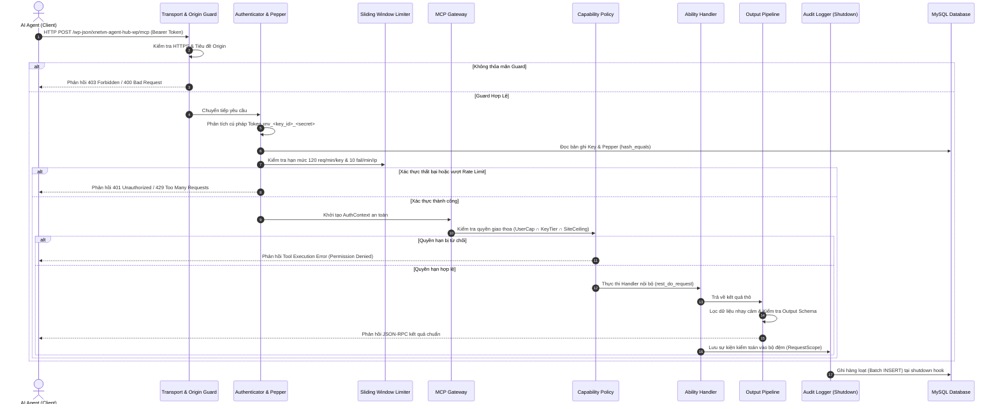
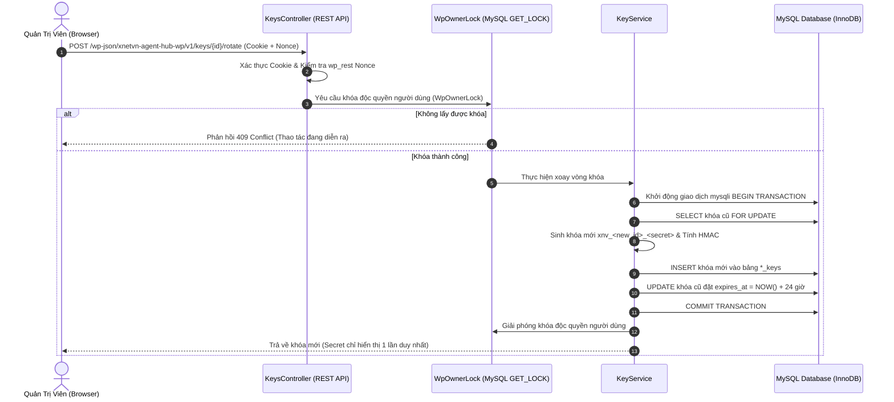

# Sơ Đồ Luồng Dữ Liệu Chính (Data Flow Diagram - DFD)

> **Mô hình hóa đường đi của dữ liệu qua các tầng xử lý của xNetVN Agent Hub WP.**

---

## 1. Sơ Đồ Xử Lý Luồng Yêu Cầu MCP (MCP Request Flow)

---

## 2. Sơ Đồ Luồng Xoay Vòng Khóa API Nguyên Tử (Atomic Key Rotation Flow)

